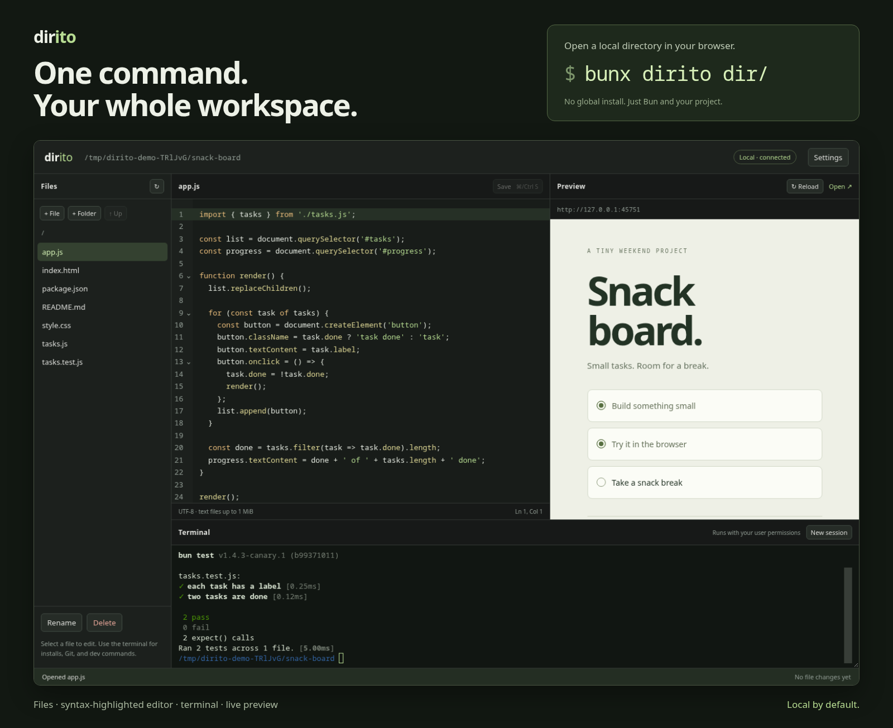

# dirito



A browser workspace for a local directory: files, a text editor, an interactive terminal, coding agents, and an app preview.

```sh
bunx dirito dir/
```

Requires Bun 1.3.5 or newer with `Bun.Terminal` support. A shell must be installed. No global install needed.

```sh
bunx dirito --watch dir/
bunx dirito dir/ --watch --proxy /api=http://localhost:3001
```

The browser opens automatically. Use `--no-open` to print the URL without opening it, and `--port 4000` to change the workspace port. `--port 0` chooses an available port. The executable uses a Bun shebang, so no `--bun` flag is needed.

For local development, run `bun install` followed by `bun index.ts dir/ --watch`. You can also run `bun link` to make `dirito` available locally.

## Workspace

- Drag the dividers to resize the file manager, editor/workspace-view split, and terminal. Focus a divider and use arrow keys to resize, Shift+arrow for larger steps, or Home/End for the size limits. On narrow screens, panels stay stacked.
- Browse files, create files and folders, rename items, and delete files or empty folders with explicit path confirmation. Use the arrow beside a folder to enter it, or double-click its name.
- Edit UTF-8 text files up to 1 MiB with CodeMirror 6, line numbers, undo/redo, and syntax highlighting for JS/TS, JSX/TSX, HTML, CSS, JSON, and Markdown. Other files open as plain text. Tab indents; Escape then Tab moves focus out of the editor. Save with Ctrl+S or Cmd+S. Unsaved changes trigger a discard warning. Saves use a temporary file and refuse stale versions instead of silently overwriting disk changes.
- Use the real shell to install dependencies, run Git, set environment variables, and start development commands. Terminal apps, colors, keyboard shortcuts, and resizing work through a PTY and xterm.js. Closing the page ends its terminal session.
- The **Agent** view opens by default. Choose an installed **Codex**, **Pi**, or **Claude Code**, select a thinking level, and click **Start**. Agents run in the workspace directory using your existing CLI login and settings. Install and log in to the CLI locally first. Switching between **Agent** and **Preview** keeps the session alive; **Stop**, **Restart**, or closing the page ends it. Dropdown changes apply to the next session.
- Preview static files on a separate localhost port. Enter a workspace-relative file or folder in the preview path field, then press Enter or Go. For example, use `demo.html` or `examples/`. Folders serve their own `index.html`. Reload and Open keep the selected path. Enable watching in Settings or pass `--watch` for HTML live reload. File changes appear in the bottom bar; `.git` and `node_modules` changes are ignored.
- Configure one HTTP proxy in Settings or with `--proxy`. `/api=http://localhost:3001` forwards `/api/users` to `http://localhost:3001/api/users`. The path prefix is retained. Use `/=http://localhost:5173` to preview a framework dev server that you start in the terminal.

Thinking uses Codex's `model_reasoning_effort`, Pi's `--thinking`, or Claude's `--effort`. **Default** leaves your CLI configuration unchanged. Available levels depend on the installed CLI version and selected model; use Default if a level is unsupported. Dirito does not bypass agent approvals or sandbox settings, and opening the workspace does not start an agent automatically.

The editor has syntax highlighting, but no language server. Proxying is HTTP only, so upstream WebSocket HMR is not forwarded. Use the framework's own URL for its HMR, or Reload in the preview. Renames never overwrite existing destinations. Non-empty folders must be cleaned up deliberately in the terminal.

## Security

Both servers bind to `127.0.0.1`. The private workspace URL contains a random access token. File, terminal, and agent APIs require it and reject foreign browser origins. Project previews run on a separate port in a sandboxed iframe, without the workspace token. Paths and symlinks cannot escape the selected directory through file APIs; preview serving also blocks `.git` and `.env` paths.

The terminal is **not sandboxed**. Commands and agent processes run as your user and can access files outside the directory, subject to any sandbox enforced by the agent CLI. Only open trusted projects. Keep the private workspace URL secret and do not expose either server through a tunnel or reverse proxy. The static preview serves other workspace files to local clients.

```sh
bun test
bun run typecheck
```
